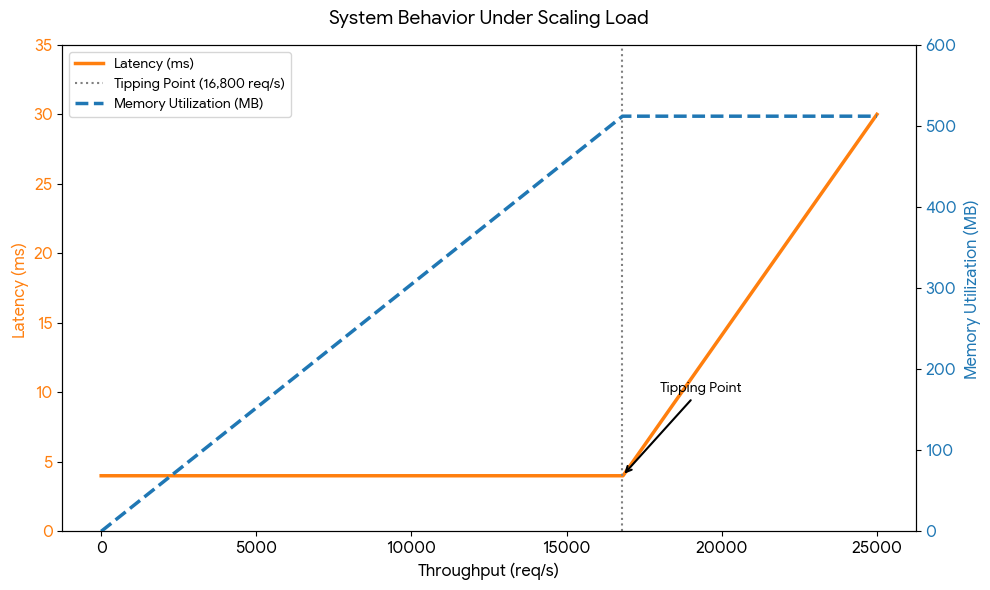

<p align="center">
  
</p>

<p align="center">
  <a href="https://github.com/rafifmsn/trust/actions/workflows/ci.yml">
    
  </a>
  <a href="https://elysiajs.com">
    
  </a>
  <a href="https://github.com/rafifmsn/trust/blob/main/LICENSE">
    
  </a>
</p>

<p align="center">
  A high-performance, containerized link verification microservice built natively with Bun, Elysia, Redis, and Astro. Designed to classify incoming URLs and domains against a trusted whitelist database using high-throughput, sub-millisecond O(1) fast-path lookups.
</p>

<p align="center">
  <a href="#highlights">Highlights</a> ·
  <a href="#architecture">Architecture</a> ·
  <a href="#quickstart">Quickstart</a> ·
  <a href="#api">API</a> ·
  <a href="#deployment">Deployment</a> ·
  <a href="#benchmarks">Benchmarks</a>
</p>

## Highlights
* **Decoupled Monorepo Architecture**: Clean separation of frontend UI (Astro, Starwind UI) and backend API (Elysia, Bun, Redis) using Bun Workspaces.
* **Dynamic Dev Proxying**: Elysia dynamically proxies static routes to the Astro hot-reloading dev server in development, enabling real-time UI changes on the backend port (3000) without manual rebuilding.
* **High Throughput**: Capable of processing up to ~16,800 domain verifications per second under concurrency (tested with ~9,000+ whitelisted domains).
* **Hybrid Data Store**: Local RAM caches provide $<1\text{ms}$ query fast-path lookups, backed by a centralized Redis state synchronization cluster.
* **Zero-Downtime Hot-Reload**: Whitelist seeding changes take effect instantly across all mesh instances via Redis Pub/Sub channels without stack restarts.
* **Zero-Allocation Levenshtein**: Edit distance matrix calculation uses module-scoped, pre-allocated `Int32Array` buffers to completely eliminate JavaScript garbage collection overhead.

## Architecture

```
├── Dockerfile                    # Multi-stage optimized Alpine builder (Node 22 + Bun)
├── docker-compose.yml            # Base Docker Compose services & network mapping
├── docker-compose.benchmark.yml  # K6 benchmarking configuration
├── docker-compose.dev.yml        # Local development configuration override
├── docs/
│   └── architecture.md           # Deep-dive architecture & decision blueprint
├── package.json                  # Root workspaces package configuration
├── .github/
│   └── workflows/
│       └── ci.yml                # GitHub Actions CI pipeline
├── backend/
│   ├── package.json
│   ├── src/
│   │   ├── index.ts              # Elysia entrypoint and process signal handlers
│   │   ├── config.ts             # Env configuration parser
│   │   ├── routes/               # Route definitions & static file serving/proxy
│   │   ├── controllers/          # Domain triage and sync controls
│   │   └── utils/                # eTLD+1 Sanitizer (Punycode normalizer) & Levenshtein
│   └── tests/
│       └── unit.test.ts          # Backend unit test suite
├── frontend/
│   ├── package.json
│   ├── src/
│   │   ├── pages/
│   │   │   ├── index.astro       # Core dashboard UI
│   │   │   └── 404.astro         # Custom static 404 error page
│   │   └── layouts/              # Base templates & Starwind styling
│   └── astro.config.ts           # Astro static compilation config
└── seed/
└── domains.json              # Whitelist base seed file
```

A deep dive into engineering decisions, mathematical optimizations, and serverless constraints is available in **[docs/architecture.md](./docs/architecture.md)**.

## Quickstart

### 1. Environment Setup
Copy the environment variables blueprint to create your active profile:
```bash
cp .env.example .env
```

### 2. Local Workspaces Commands

Since this repository uses Bun Workspaces, you can run all commands directly from the root directory:

* **Install all dependencies** (for both frontend and backend):
```bash
bun install
```

* **Run entire stack in development** (starts both Astro dev server and Elysia backend concurrently with hot-reloading):
```bash
bun run dev:all
```

* **Run specific workspaces**:
* Backend API only: `bun run dev:backend` (or manually: `cd backend && bun run dev`)
* Frontend UI only: `bun run dev:frontend` (or manually: `cd frontend && bun run dev`)

* **Build Frontend Assets**:
```bash
bun run build:frontend
```

*The API listens at http://localhost:3000. In development mode, Elysia dynamically reverse-proxies assets to Astro's hot-reloading server on port 4321. You may see a temporary browser console warning regarding Vite WebSocket connection fallback, which is safe and expected.*

### 3. Whitelist Seeding

1. Open the seed file at [`seed/domains.json`](https://www.google.com/search?q=./seed/domains.json).
2. Append your new target apex domain to the array (e.g. `"mybrand.com"`) and save the file.
3. Apply the changes using one of the following methods:
* **Option A: Live Cluster Sync (Zero Downtime, Recommended)**
Send an authenticated request to the hot-reload endpoint so Elysia reconciles the Redis state and broadcasts a reload notification to all worker nodes:
```bash
curl -X POST -H "Authorization: Bearer <ADMIN_API_KEY>" http://localhost:3000/api/v1/admin/sync
```

* **Option B: Restart the API Container (Short Downtime)**
Force the API process to restart while keeping `redis-store` alive:
```bash
docker compose restart trust
```

### 4. Running Tests

Unit tests run against a local Redis setup and verify domain sanitization, Levenshtein edit distance logic, exact RAM whitelist matching, and Punycode-based homoglyph spoofing:
```bash
cd backend
bun test
```

## API

### 1. Domain Verification
* **Method**: `POST`
* **Path**: `/api/v1/verify`
* **Headers**: `Content-Type: application/json`
* **Body Schema** (maximum 20 domains per request):

```json
{
  "domains": ["google.com", "paypa1.com", "googĺe.com", "unregistered.com"]
}
```

* **Sample Response**:
```json
{
  "success": true,
  "data": [
    {
      "input": "google.com",
      "matched": "google.com",
      "status": "VERIFIED"
    },
    {
      "input": "paypa1.com",
      "matched": "paypal.com",
      "status": "TYPO_IMPERSONATION"
    },
    {
      "input": "googĺe.com",
      "matched": null,
      "status": "HOMOGLYPH_IMPERSONATION"
    },
    {
      "input": "unregistered.com",
      "matched": null,
      "status": "UNKNOWN"
    }
  ]
}
```

* **Classification Statuses**:
* `VERIFIED`: Exact match against a whitelisted brand.
* `TYPO_IMPERSONATION`: Fuzzy match within edit distance of 1 from a whitelisted brand (typosquatting).
* `HOMOGLYPH_IMPERSONATION`: Contains Unicode lookalike characters (homoglyph spoofing).
* `UNKNOWN`: Safe or unrecognized domain that does not resemble any whitelisted brands.

### 2. Administrative Hot-Reload
* **Method**: `POST`
* **Path**: `/api/v1/admin/sync`
* **Headers**: `Authorization: Bearer <ADMIN_API_KEY>`

## Deployment

Our [`Dockerfile`](https://www.google.com/search?q=./Dockerfile) compiles the Astro frontend under `node:22-alpine` to satisfy Astro engine requirements, then copies the compiled static assets into the `oven/bun:1.2.2-alpine` runtime runner for Elysia.

Build and run the stack:
```bash
docker compose up -d --build
```

## Benchmarks

To measure performance without resource contention between `k6` and the API, use the dedicated hardware-partitioned benchmark compose file:

1. **Start the isolated benchmark stack** (pins the API to CPU cores `0-1` at 512MB RAM and Redis to core `2` at 256MB RAM with disk-writing disabled):
```bash
docker compose -f docker-compose.benchmark.yml up -d --build
```

2. **Run the k6 load test** (executes on CPU cores `3` and above via Docker, or locally via `k6 run backend/tests/k6-load.js`):
```bash
docker run --rm --network host -i grafana/k6 run - <backend/tests/k6-load.js
```

3. **Tear down the benchmark stack**:
```bash
docker compose -f docker-compose.benchmark.yml down
```

### Results

Results from a 30-second load test on an **AMD Ryzen 5 6600H (6 Cores / 12 Threads) @ 4.56GHz**, Ubuntu 24.04.4 LTS (Kernel 7.0.0), with `trust-backend` pinned to cores `0-1` (512MB limit) and `redis-store` pinned to core `2` (256MB limit, AOF disabled):



#### k6 Load Test Metrics (270 Max VUs, ~9,000+ Whitelisted Domains)

| Metric | Value |
| --- | --- |
| **Throughput (Request Rate)** | **16,797.55 req/s** |
| **Total Processed Requests** | **504,374** |
| **Average Response Latency** | **4.18 ms** |
| **Median Response Latency** | **3.89 ms** |
| **p90 Response Latency** | **7.83 ms** |
| **p95 Response Latency** | **8.85 ms** |
| **Max Response Latency** | **20.47 ms** |
| **Network Data Received** | **116 MB** (3.9 MB/s) |
| **Network Data Sent** | **366 MB** (12 MB/s) |

#### System Behavior Under Scaling Load

**Performance Analysis**: Latency remains flat at ~4ms up to the **16,800 req/s** tipping point. Beyond this threshold, memory utilization hits its 512MB limit and response times scale linearly due to request queuing while keeping the footprint safe from container OOM crashes.

> Note: 99.44% of HTTP requests returned 429 (Rate Limited) or 413 (Payload Too Large). This is expected under stress and confirms the abuse protection layers shield the API from resource depletion.
