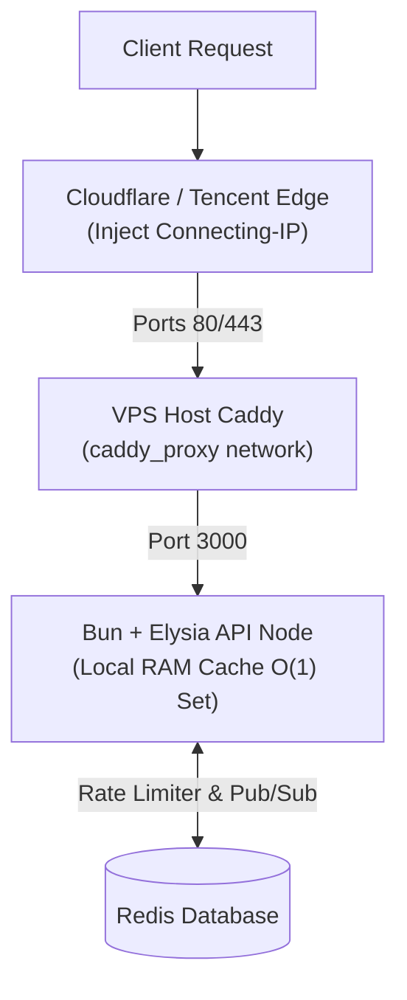
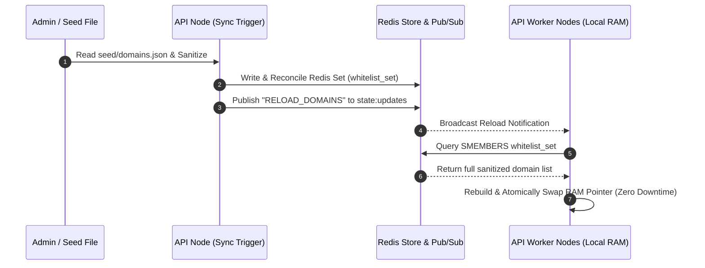
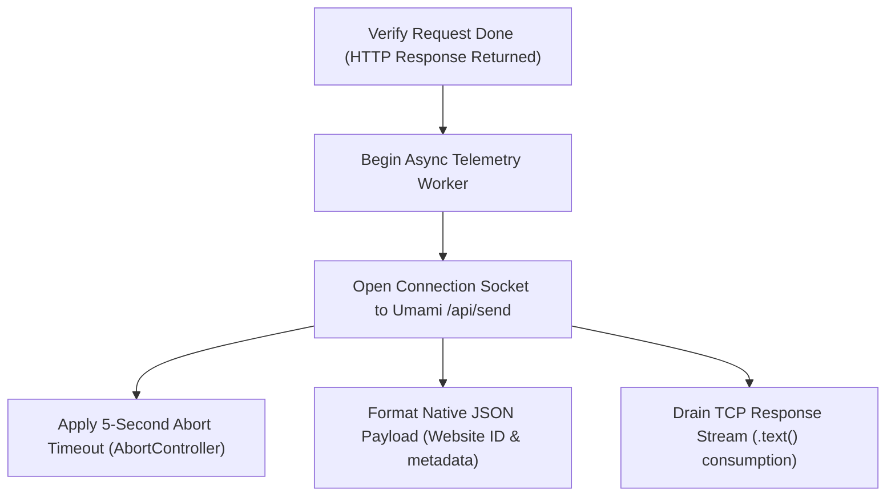

# Technical Architecture Manual

This document provides a clean overview of the architectural flow, component topologies, and engineering decisions implemented in the rafifmsn/trust.

## 1. High-Level System Flow & Ingress

The application separates edge routing, SSL termination, and client validation from the internal classification services.

### Development Proxy & Decoupled Frontend
In local development, the repository functions as a Bun Monorepo Workspace. To preserve hot-reloading (HMR) without manually rebuilding the Astro frontend:
* **Elysia (Port 3000)** is the main gateway.
* If `NODE_ENV=development` and the incoming path is not an API route, Elysia dynamically proxies the request to the **Astro Dev Server (Port 4321)**.
* Standard assets inside `/_astro/*` utilize HMR. (If the browser's Vite WebSocket fails to connect to port 3000, it automatically falls back to port 4321 directly, preserving hot-reloading).

### Ingress Header Resolution

Edge proxy routing headers are resolved to identify client IP. We inspect headers in order of priority (prioritizing Cloudflare):

1. `cf-connecting-ip` (Cloudflare CDN)
2. `eo-connecting-ip` (Tencent EdgeOne)
3. `x-forwarded-for` (Fallback proxy array)
4. `127.0.0.1` (Local loopback default)

## 2. Decoupled 5-Layer Triage Pipeline

All queries submitted to `/api/v1/verify` pass through a cascading 5-layer pipeline designed to execute fast checks first and avoid expensive computational blocks.

### Pipeline Details:

* **Layer 1: Structural Weight Guard (O(1))**: Limits request batch payload size to $\le 20$ domains. Prevents server memory exhaustion.
* **Layer 2: Cost-Based Rate Limiting (O(1))**: A Redis Lua script enforces a token bucket constraint. Deducts $N$ tokens for $N$ submitted domains (Capacity: 100, Refill: 10/s). If resources are depleted, returns HTTP `429`. If Redis connection fails, the limiter fails open to prioritize service availability.
* **Layer 3: Homoglyph Triage (O(N))**: Instantly flags internationalized homoglyph attacks containing `xn--` spoof headers as `HOMOGLYPH_IMPERSONATION`. To support raw Unicode domain submissions in the API, the sanitizer runs `domainToASCII` to normalize homoglyphs (e.g. `googĺe.com` -> `xn--googe-95a.com`) before performing suffix checking.
* **Layer 4: In-Memory Exact Match (O(1))**: Resolves clean, ASCII/Punycode-normalized eTLD+1 apex domains (parsed via suffix-aware static Trie `tldts`) against a local JavaScript `Set` cache in RAM. Matched items return `VERIFIED`.
* **Layer 5: Levenshtein Distance Matrix (O(K * M))**: Fuzzy check computes insertion/deletion/substitution distance of $\le 1$ against whitelisted domains (returning `TYPO_IMPERSONATION`). To optimize lookup time, the whitelisted domains are pre-partitioned in memory by string length (`whitelistByLength`). The engine only runs Levenshtein checks against candidate domains whose length is exactly $L-1$, $L$, or $L+1$ relative to the input domain's length $L$, bypassing $\ge 90\%$ of comparisons.

## 3. Zero-Downtime Hot-Reload Setup

To allow seamless whitelist updates without interrupting query traffic or resetting transient rate limit keys:

1. **State Seeding**: On start, the server reads `seed/domains.json`, sanitizes the input list, populates Redis, and constructs the local RAM cache.
2. **Cluster synchronization**: When an admin triggers `/api/v1/admin/sync` (protected by the `ADMIN_API_KEY` Authorization token):
    * The triggered container reads the updated mount file, reconciles the Redis `whitelist_set` keys, and broadcasts a reload signal over the `state:updates` Redis Pub/Sub channel.
    * All active API instances capture the signal, execute `SMEMBERS whitelist_set` (replacing the blocking `KEYS` command), rebuild local memory caches, and atomically swap pointers with zero downtime.
3. **Graceful Shutdown**: Intercepts `SIGTERM` / `SIGINT` signals to unsubscribe from Pub/Sub channels and cleanly drain/close the Redis connection pools.
4. **Boot Retry Resilience**: If the API container boots before Redis is online, it retries connecting 5 times with a 1.5-second delay to prevent container crash-loops.

## 4. Telemetry Architecture (Client-less HttpClient)

Instead of using a heavy, dependency-bloated NPM library, telemetry dispatches events directly using standard `fetch()` requests to the Umami REST endpoint `/api/send`:

* **Client Safety**: Operates as an un-awaited background micro-task so it never blocks HTTP responses.
* **Self-Contained Rejections**: Errors and connection timeouts are captured inside the fetch `.catch()` block. This prevents unhandled promise rejections.
* **Socket Leak Protection**: Always resolves and consumes the response data stream via `res.text().catch(() => {})`. This forces the engine to immediately drain and release TCP network sockets rather than leaving them hanging in memory.
* **Non-Prod Isolation**: Telemetry remains completely inactive in local development modes (`NODE_ENV !== 'production'`).

## 5. Security & Validation Controls

* **Administrative Authorization**: The `/api/v1/admin/sync` endpoint requires a Bearer token verification (`Authorization: Bearer <ADMIN_API_KEY>`). If missing or misconfigured, it returns HTTP `401`.
* **Seed Sanitization**: Synchronizer verifies seed domains before seeding, removing empty entries, paths, spaces, or values exceeding invalid lengths.
* **Levenshtein Boundary Guard**:
* Domain inputs longer than 253 characters (RFC 1035 max DNS limits) are rejected immediately as `UNKNOWN`.
* Max brand length (`maxWhitelistLength`) is calculated dynamically on cache updates. If an incoming domain's length is larger than `maxWhitelistLength + 1`, the edit-distance loop is bypassed in $O(1)$ time, mitigating ReDoS/CPU exhaustion attacks.

## 6. Multi-Environment Docker Setup

Configurations are separated across three compose parameters:

### Base Profile (`docker-compose.yml`)

Binds the service definitions, persists database data to a dedicated Docker volume, and maps runtime variables from the host's `.env` configuration file:

* `REDIS_URL=redis://redis-store:6379`
* `SEED_DOMAINS_PATH=/app/seed/domains.json`
* Pass-throughs: `ADMIN_API_KEY`, `UMAMI_URL`, and `UMAMI_WEBSITE_ID`.

### Dev Profile (`docker-compose.dev.yml`)

* Deploys hot-reload filesystem bind volumes for `./src` and `./seed`.
* Exposes Elysia to `127.0.0.1:3000` and Redis port `6379` to localhost to support local test running.

### Benchmark Profile (`docker-compose.benchmark.yml`)

* Sets strict CPU core allocations (`cpuset: "0-1"` for Elysia API, `cpuset: "2"` for Redis) and RAM caps (512MB for API, 256MB for Redis) to ensure precise, hardware-partitioned load testing.
* Disables Redis Append-Only File (`--appendonly no`) to eliminate disk I/O latency bottlenecks during benchmarks.

### Prod Profile (`docker-compose.prod.yml`)

* Limits container logs size (`max-size: "10m"`, `max-file: "3"`) to prevent storage leakage.
* Mounts seed directories as read-only.
* Hides host-level ports and joins the external `caddy_proxy` network, securing internal resources.
